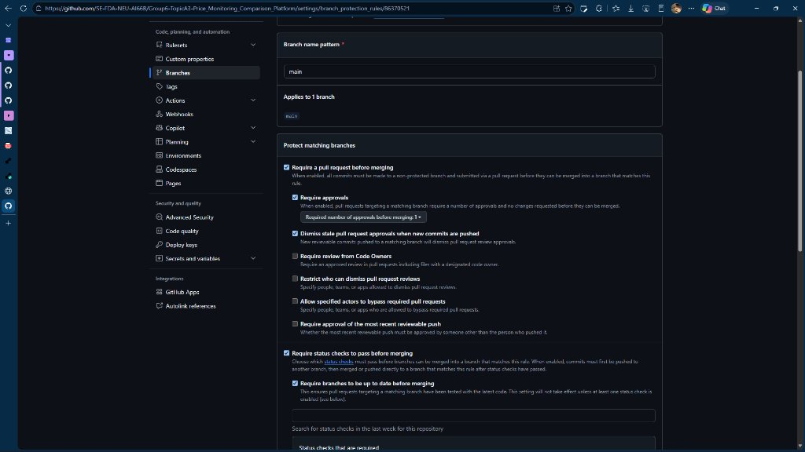

# PriceLens Operations Guide

## 1. How to run and release

- **Public Production URL:** https://pricelens-lll0.onrender.com (Health probe: https://pricelens-lll0.onrender.com/health)
- **Hosting Platform:** Render Web Service (Node.js 22, Express 5 serving the built Vite frontend and `/api/*` routes on `0.0.0.0:$PORT`) connected over TLS (`DB_SSL=true`) to managed PostgreSQL (`DATABASE_URL`). Secrets reside exclusively in Render Environment Variables and GitHub Secrets, never in Git.
- **Release Pipeline (`merge → CI green → deploy`):** Every change is pushed to a feature branch and opened as a Pull Request into `main`. Once a teammate approves via **Review changes** and the `Install, Build & Test` CI workflow turns green, merging into `main` triggers the `Deploy to Production` job (`needs: test`) and Render deployment. Render executes `npm run build` (installing dependencies and compiling `frontend/dist`) followed by `npm start` (`npm run db:init && npm --prefix backend start`), which runs idempotent schema migrations, seeds the 10 demo products, and starts the server.
- **How to Roll Back a Broken Release:**
  1. **Platform Rollback (Immediate, < 1 minute):** Open Render Dashboard $\rightarrow$ `PriceLens` $\rightarrow$ **Deploys**, locate the previous green deployment commit (e.g., `v1.0`), and click **Rollback to this deploy**.
  2. **Git Revert Rollback (Permanent on `main`):** Revert the faulty merge commit (`git revert -m 1 <merge-sha> --no-edit`), merge the revert PR after green CI so `main` redeploys cleanly, and confirm `GET https://pricelens-lll0.onrender.com/health` returns HTTP `200`.

## 2. The CI pipeline

GitHub Actions (`.github/workflows/ci.yml`) runs automatically on every `push` and `pull_request` to `main`. A full run takes **15–22 seconds**.

- **Latest Green CI Run on `main`:** https://github.com/SE-FDA-NEU-AI66B/Group6-TopicA3-Price_Monitoring_Comparison_Platform/actions/runs/43717413894

| Job / Step | Command / Action | What It Checks | Typical Duration |
| :--- | :--- | :--- | :--- |
| Checkout & Node.js 22 | `actions/checkout@v4` + `actions/setup-node@v4` | Checks out commit and configures Node.js 22 with npm lockfile cache | ~3s |
| Install dependencies | `npm ci` (`backend/` & `frontend/`) | Verifies lockfile integrity and installs exact dependency versions | ~4s |
| Build frontend bundle | `npm --prefix frontend run build` | Verifies Vite compiles all 22 frontend modules into `frontend/dist` without error | ~2s |
| Run frontend unit tests | `npm --prefix frontend test` | Executes 8 unit tests covering formatting, URL resolution, and validation | ~1s |
| Run automated test suite | `npm test` | Executes all 72 acceptance tests across US01–US12 (normal, error, and boundary cases) | ~2s |
| Deploy to Production | `deploy` job (`needs: test`, `main` push only) | Triggers production deployment only after `Install, Build & Test` passes on `main` | ~3s |

## 3. Monitoring

- **What the App Logs & Where to Read It:** `createRequestLogger` (`backend/src/middleware/request-logger.js`) and `errorHandler` (`backend/src/middleware/error-handler.js`) log HTTP `5xx` responses, slow requests ($\ge 1000\text{ ms}$), and unexpected server/database errors (`method`, sanitized `path`, `status`, `duration_ms`) to stdout/stderr. Team members inspect live and historical logs in **Render Dashboard $\rightarrow$ `PriceLens` $\rightarrow$ Logs**.
- **What It Never Logs:** `sanitizeLogPath`, `sanitizeLogText`, and `redactSensitiveFields` strip URL query parameters and replace passwords, `password_hash`, session tokens, cookies, `Authorization` headers, `postgres://` database URIs, and user email addresses (PII) with `[REDACTED]`. Stack traces are suppressed when `NODE_ENV=production`.
- **What `/health` Checks:** `GET /health` (`backend/src/modules/health/health.routes.js`) executes `SELECT 1 AS healthy` against the PostgreSQL connection pool with `Cache-Control: no-store`. It returns HTTP `200` (`{"status":"ok","checks":{"application":"up","database":"up"}}`) when healthy, and HTTP `503` (`{"status":"unhealthy","checks":{"application":"up","database":"down"}}`) without exposing credentials when the database fails.
- **Two Watched Metrics:** We track **error rate** (`server_error_rate` target $< 1\%$) and **API response time** (`duration_ms` target $< 1000\text{ ms}$). If either degrades, `HTTP 5xx server error response` or `Slow HTTP response detected` warnings appear in Render Logs and `/health` alerts on `503`.

## 4. Known risks and technical debt

| Item | Layer | What could happen | Plan |
| :--- | :--- | :--- | :--- |
| Render free-tier cold start | `infrastructure` | After 15 minutes of inactivity, the free web instance spins down and the first request takes 30–50 seconds to wake up. | `accepted — Free hosting constraint for course demo; warming up `/health` 2 minutes before live presentations avoids cold-start delay.` |
| In-memory operational metrics | `code` | Counters in `operationalMonitor` (`request-logger.js`) reset whenever the Node.js process restarts or redeploys. | `accepted — Render platform logs persist across restarts, providing sufficient history for single-instance operation.` |
| Simulated retailer catalog adapters | `data` | URL resolution (`US04`) and price observation (`US05`) use deterministic adapter fixtures rather than scraping anti-bot live e-commerce HTML. | `accepted — Deterministic adapters guarantee repeatable CI and live demo behaviour without external scraper breakage.` |
| JSONL file email outbox in demo mode | `infrastructure` | When SMTP credentials are not configured, `US05` notifications are persisted in PostgreSQL and written to `.local/pricelens-email-outbox.jsonl` instead of external inbox delivery. | `accepted — Database notification records and outbox logs prove threshold-crossing delivery without risking external spam filters.` |
| Browser E2E tests use JSDOM/HTTP rather than headless Chromium | `tests` | Automated checks verify HTML landmarks, links, and live API flows via Node HTTP/DOM inspection rather than full GPU browser rendering. | `#208` |

## 5. Maintenance plan

| Area | What to do | Owner | How often |
| :--- | :--- | :--- | :--- |
| **Bugs** | Triage newly reported issues on the GitHub Project Board, reproduce with a failing test in `tests/`, and merge a reviewed fix PR into `main`. | `@Tienachilles` & `@davvph` | Weekly / within 48h for P0 bugs |
| **Dependency updates** | Review GitHub Dependabot alerts, run `npm audit` in `backend/` and `frontend/`, and test upgrades via the CI pipeline before merging. | `@helian16` | Bi-weekly |
| **Backups of the data** | Verify PostgreSQL snapshot state, export critical tables via `pg_dump`, and test idempotent recovery with `npm run db:init`. | `@minh7322` | Weekly & before each release |
| **Monitoring** | Check `https://pricelens-lll0.onrender.com/health`, inspect Render **Logs** for `5xx` errors or slow requests ($\ge 1000\text{ ms}$), and review latency metrics. | `@minh7322` | Daily during active demo weeks |
| **Keeping the docs true** | Audit `README.md`, `docs/operations.md`, `docs/SETUP.md`, and `docs/testing.md` against current routes, scripts, and environment variables in every PR review. | `@adcc17` | Every Pull Request / Per release |

## 6. Lessons learned

1. **Nested Directory Uploads on GitHub Web UI Caused Cross-PR Merge Conflicts**
   - **What happened:** During early Sprint 5 PR creation (#220, #221), uploading folders through the GitHub web interface accidentally nested `backend/backend/` and `frontend/frontend/` and staged overlapping files in #222, causing severe `CONFLICTING` states on GitHub.
   - **What we changed:** We restored the flat root directory structure in a shared base commit, scoped each sub-issue PR to strictly disjoint file paths, and switched to CLI-verified `git add <explicit-files>` workflows.
   - **What we would do differently next time:** Never use browser drag-and-drop uploads for multi-folder changes; always branch from `origin/main` via Git CLI and check `git status` / `git diff --stat` before opening a PR.
2. **Production `NODE_ENV=production` Skipped Frontend Build Tooling (`vite: not found`)**
   - **What happened:** On our first Render deployment with `NODE_ENV=production`, Render's default build skipped `devDependencies` where `vite` was declared, causing `vite build` to fail with exit code `127`.
   - **What we changed:** We updated the build command and root `package.json` `build` script to explicitly run `npm --prefix frontend install --include=dev` and chained `npm --prefix backend run db:init` into `npm start`.
   - **What we would do differently next time:** Test the exact production build and start commands locally with `NODE_ENV=production` in a clean environment before triggering the first cloud deployment.
3. **Requirements and Story Issue Drift in Early Milestones**
   - **What happened:** In Milestone 1 and Milestone 3, some User Story descriptions on GitHub Issues drifted from `docs/requirements.md` and P0 navigation entry points were not immediately obvious from the landing page.
   - **What we changed:** We established `docs/requirements.md` and `docs/traceability.md` as the single source of truth, connected all 5 P0 flows with click-only links from the first screen, and added 72 automated acceptance tests (`npm test`).
   - **What we would do differently next time:** Enforce a single traceability table and automated acceptance test IDs (`TC-USNN-XX`) from Sprint 1 whenever a story or business rule is edited.
