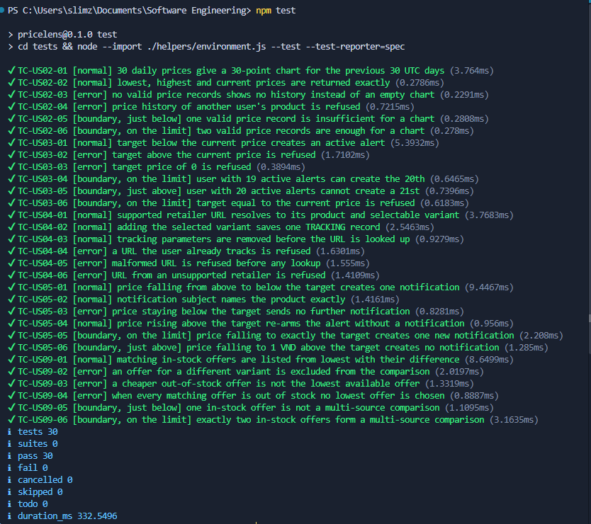

# Testing

Automated test suite for the five P0 stories of PriceLens. Conventions for
writing tests and editing this document are in
[testing-guidelines.md](testing-guidelines.md).

## 1. What we test, and why

| Layer | Where | How we test it | Why |
|---|---|---|---|
| Services | `backend/src/modules/**/*.service.js`, `backend/src/background/**` | Unit tests that call exported functions directly with plain arguments | Every business rule (BR1, BR2, BR4, BR5, BR6, BR8) is decided here, so a mistake in this layer gives users a wrong price, alert or notification |
| Repository | `backend/src/modules/**/*.repository.js` | Run through the service tests against a fake database client that answers each query; no PostgreSQL | Checks the values each rule sends to the database (variant, currency, comparison operator) and how rows are mapped, without needing a database on the test machine |
| Routes | `backend/src/modules/**/*.routes.js` | Not tested in this suite | Routes only read the request and turn a service result or error into an HTTP response; they hold no business rule |
| Interface | `frontend/src/**` | Not tested in this suite | Checked by hand against every P0 acceptance criterion in the browser; the screens still change often, so automated UI tests would break on layout changes rather than on rule changes |

### Where the risk is

We tested the alert and notification rules most (US03 and US05): they
contain the only numeric limits that decide whether a user is refused or
sent an email, so an off-by-one mistake (`<` instead of `<=`, 20 instead of
19) goes unnoticed in a demo but misleads users. Every numeric rule is
therefore tested on both sides of its limit, and the comparison operators
written in SQL are read and evaluated by the fake database so that changing
them turns a test red.

### Known gaps

- **US02:** the date and `IN_STOCK` filtering of price history runs in SQL
  (`price-history.repository.js`). Because the suite runs without a
  database, it checks that the 30-day UTC window is computed correctly and
  how rows are assembled, but not the SQL query itself.
- **US03:** alert creation runs inside a database transaction, so the tests
  replace the database connection with a fake client. BR2 price comparisons
  are written as PostgreSQL `NUMERIC` expressions; the fake evaluates the
  same comparison operator the service sends, so a change from `<` to `<=`
  is caught, but PostgreSQL's own decimal arithmetic is not exercised.
- **US04:** duplicate URLs (BR6) are rejected by a unique constraint in
  PostgreSQL, not by application code. The tests simulate the database's
  duplicate-key error and check that it becomes the "already being tracked"
  response; the constraint itself is not exercised.
- **US05:** the tests cover how a new price creates a pending notification
  (BR4 and the subject line). Sending the email within 5 minutes depends on
  the delivery job, the real clock and PostgreSQL locks, so it is not
  checked here; it is verified in `docs/p0-acceptance.md`. The fake database
  evaluates the same threshold comparisons the processor sends to
  PostgreSQL.
- **US09:** choosing each retailer's latest price, sorting offers (in stock
  first, then by price) and computing the difference from the lowest run in
  SQL (`offer-comparison.repository.js`). The fake database returns rows in
  that order and filters them by the variant and currency the service sends,
  so BR5 and the BR8 status rules are checked, but the SQL sorting and
  arithmetic are not.

## 2. Test cases for every P0 story

Each story has at least one `normal` case that succeeds, at least one `error`
case where a business rule refuses the input and, when its rule contains a
number, boundary cases on both sides of that number. Every ID below matches
a test with the same ID in `tests/`.

### US02 — View product price history

US02 has no numbered business rule. Its numeric limit is the chart
threshold: a chart needs at least 2 valid daily prices.

| ID | Story | Input | Expected | Kind |
|---|---|---|---|---|
| TC-US02-01 | US02 View price history | 30 valid daily prices, viewed at 2026-10-20 12:00 UTC (AC1) | `AVAILABLE`; exactly 30 points; window 2026-09-20 → 2026-10-19 UTC | normal |
| TC-US02-02 | US02 View price history | Lowest 18,500,000 VND, highest 20,000,000 VND, current 18,900,000 VND (AC2) | Summary shows exactly 18,500,000 / 20,000,000 / 18,900,000 VND | normal |
| TC-US02-03 | US02 View price history | No valid price records (AC4) | `NO_HISTORY`; "No price history available"; no points, no summary | error |
| TC-US02-04 | US02 View price history | Request the history of a product the user does not own | Refused: 404 `TRACKED_PRODUCT_NOT_FOUND`, "Tracked product not found" | error |
| TC-US02-05 | US02 View price history | 1 valid price record (AC3) | `INSUFFICIENT_DATA`; "Insufficient data for a 30-day chart" | boundary, just below |
| TC-US02-06 | US02 View price history | 2 valid price records | `AVAILABLE`; 2 points | boundary, on the limit |

### US03 — Create a price alert

BR1 limits a user to 20 active alerts. BR2 requires a target price above 0
and strictly below the current price. All cases use a current price of
15,000,000 VND.

| ID | Story | Input | Expected | Kind |
|---|---|---|---|---|
| TC-US03-01 | US03 Create a price alert | Target 14,000,000 VND (AC1) | Alert saved as `ACTIVE` with target 14,000,000 and current 15,000,000 VND | normal |
| TC-US03-02 | US03 Create a price alert | Target 16,000,000 VND (AC2) | Refused: 422 "Target price must be lower than the current price"; nothing saved (BR2) | error |
| TC-US03-03 | US03 Create a price alert | Target 0 VND (AC3) | Refused: 422 "Target price must be greater than 0"; nothing saved (BR2) | error |
| TC-US03-04 | US03 Create a price alert | User already has 19 active alerts | 20th alert saved as `ACTIVE` (BR1) | boundary, on the limit |
| TC-US03-05 | US03 Create a price alert | User already has 20 active alerts (AC4) | Refused: 409 "Maximum 20 active alerts reached"; nothing saved (BR1) | boundary, just above |
| TC-US03-06 | US03 Create a price alert | Target 15,000,000 VND, equal to the current price | Refused: 422 "Target price must be lower than the current price"; nothing saved (BR2) | boundary, on the limit |

### US04 — Add a product using its URL

BR6 allows one watchlist record per normalized product URL; tracking
parameters such as `utm_source` are removed before the duplicate check. BR6
has no numeric limit, so US04 has no boundary cases. All cases use the iPhone
15 128GB Black offers from the demo data.

| ID | Story | Input | Expected | Kind |
|---|---|---|---|---|
| TC-US04-01 | US04 Add a product | `https://digital-hub.example/apple-iphone-15-128gb-black` (AC1) | Resolved to Digital Hub, Apple iPhone 15, with variant iPhone 15 128GB Black to select | normal |
| TC-US04-02 | US04 Add a product | Selected Digital Hub offer for iPhone 15 128GB Black (AC1) | One record saved with status `TRACKING` and the normalized URL | normal |
| TC-US04-03 | US04 Add a product | `https://techmart.example/apple-iphone-15-128gb-black?utm_source=qa` | Looked up as `https://techmart.example/apple-iphone-15-128gb-black` (BR6) | normal |
| TC-US04-04 | US04 Add a product | Offer whose normalized URL is already in the user's watchlist (AC2) | Refused: 409 "This product URL is already being tracked"; nothing saved (BR6) | error |
| TC-US04-05 | US04 Add a product | `not-a-url` (AC3) | Refused: 422 "Unsupported or invalid product URL"; no lookup made | error |
| TC-US04-06 | US04 Add a product | `https://unsupported.example/product` (AC3) | Refused: 422 "Unsupported or invalid product URL" | error |

### US05 — Receive a price-drop notification

BR4 sends exactly one notification when a valid price moves from above the
target to at or below it, sends nothing while the price stays at or below the
target, and re-arms only after the price rises above the target again. All
cases use an active alert on the Dell XPS 13 9340 with a target of
14,000,000 VND.

| ID | Story | Input | Expected | Kind |
|---|---|---|---|---|
| TC-US05-01 | US05 Receive a notification | Previous price 15,000,000 VND, new price 13,900,000 VND (AC1) | Exactly 1 pending notification for `demo@pricelens.local`; alert marked at or below target (BR4) | normal |
| TC-US05-02 | US05 Receive a notification | Same price drop as TC-US05-01 (AC3) | Subject is exactly "Price Drop Alert: Dell XPS 13 9340" | normal |
| TC-US05-03 | US05 Receive a notification | After a notification at 13,900,000 VND, new price 13,800,000 VND (AC2) | No further notification; alert stays at or below target (BR4) | error |
| TC-US05-04 | US05 Receive a notification | Price rises from 13,800,000 to 14,200,000 VND (AC4) | No notification; alert re-armed as above target (BR4) | normal |
| TC-US05-05 | US05 Receive a notification | Re-armed alert, price falls from 14,200,000 to 14,000,000 VND (AC4) | Exactly 1 new notification (BR4) | boundary, on the limit |
| TC-US05-06 | US05 Receive a notification | Re-armed alert, price falls from 14,200,000 to 14,000,001 VND | No notification; alert stays above target (BR4) | boundary, just above |

### US09 — Compare prices across retailers

BR5 compares only offers for the tracked variant; BR8 never picks an
out-of-stock offer as the lowest available offer. The numeric limit is the
number of in-stock offers: two or more form a multi-source comparison, exactly
one shows "No multi-source comparison is currently available". Cases use the
iPhone 15 128GB Black fixture unless stated otherwise.

| ID | Story | Input | Expected | Kind |
|---|---|---|---|---|
| TC-US09-01 | US09 Compare offers | TechMart 19,900,000 VND and Digital Hub 20,200,000 VND, both in stock (AC1) | `AVAILABLE`; TechMart listed first as the lowest offer; Digital Hub 300,000 VND above the lowest | normal |
| TC-US09-02 | US09 Compare offers | Fixture also has an in-stock iPhone 15 256GB Black offer at 18,500,000 VND (AC2) | Offers are looked up for the 128GB variant only; the 18,500,000 VND offer is not shown (BR5) | error |
| TC-US09-03 | US09 Compare offers | Gadget World 18,200,000 VND out of stock, Digital Hub 18,500,000 VND in stock | Digital Hub is the lowest available offer; Gadget World shown as `OUT_OF_STOCK` with no difference (BR8) | error |
| TC-US09-04 | US09 Compare offers | Gadget World 18,200,000 VND and Digital Hub 18,500,000 VND, both out of stock | `ALL_OUT_OF_STOCK`; "Currently out of stock across all tracked sources"; no lowest offer (BR8) | error |
| TC-US09-05 | US09 Compare offers | Dell XPS 13 9340 with one in-stock offer, TechMart 34,990,000 VND (AC3) | `SINGLE_OFFER`; "No multi-source comparison is currently available" | boundary, just below |
| TC-US09-06 | US09 Compare offers | Two in-stock offers and one out-of-stock offer | `AVAILABLE`; no message | boundary, on the limit |

## 3. Automated tests

Run the whole suite from the repository root:

```bash
npm test
```

No running server, no real database and no `.env` file are needed; the only
prerequisite is the backend dependency install described in
[SETUP.md](SETUP.md).

| Story | Test file | Test case IDs |
|---|---|---|
| US02 | `tests/us02-price-history.test.js` | TC-US02-01 – TC-US02-06 |
| US03 | `tests/us03-price-alert.test.js` | TC-US03-01 – TC-US03-06 |
| US04 | `tests/us04-add-product.test.js` | TC-US04-01 – TC-US04-06 |
| US05 | `tests/us05-notification.test.js` | TC-US05-01 – TC-US05-06 |
| US09 | `tests/us09-comparison.test.js` | TC-US09-01 – TC-US09-06 |

### Latest run

- **Date:** 2026-11-02
- **Commit:** `39e8722` (`main`)
- **Result:** 30 tests, 30 passed, 0 failed, in under one second



## 4. What the tests found

The tests found no real bug in the P0 code, so we broke a rule on purpose to
show that the tests catch it.

**Rule broken:** BR1, "a user may have at most 20 active alerts". In
`backend/src/modules/tracked-products/price-alert.service.js` we changed the
limit check

```js
if (activeAlertCount >= MAX_ACTIVE_ALERTS) {
```

to

```js
if (activeAlertCount > MAX_ACTIVE_ALERTS) {
```

which lets a user with 20 active alerts create a 21st.

**Result:** exactly one test turned red, the boundary case just above the
limit:

```text
✖ TC-US03-05 [boundary, just above] user with 20 active alerts cannot create a 21st
  AssertionError [ERR_ASSERTION]: Missing expected rejection.
    actual: undefined,
    expected: { status: 409, code: 'ACTIVE_ALERT_LIMIT_REACHED', detail: 'Maximum 20 active alerts reached' },

ℹ tests 30
ℹ pass 29
ℹ fail 1
```

TC-US03-04 (19 active alerts, creation allowed) stayed green, which shows the
pair of boundary tests pins the limit to exactly 20. We restored `>=` and the
full suite passed again (30 of 30).

Every other rule was checked the same way before its tests were merged:

| Rule broken on purpose | Test that turned red |
|---|---|
| US02: chart threshold `pointCount === 1` changed to `<= 2` | TC-US02-06 |
| US03 BR2: `target < current` changed to `<=` | TC-US03-06 |
| US04 BR6: `utm_` parameters no longer removed | TC-US04-03 |
| US05 BR4: `price <= target` changed to `<` | TC-US05-05 |
| US09 BR8: out-of-stock offers counted as available | TC-US09-03, TC-US09-04 |
