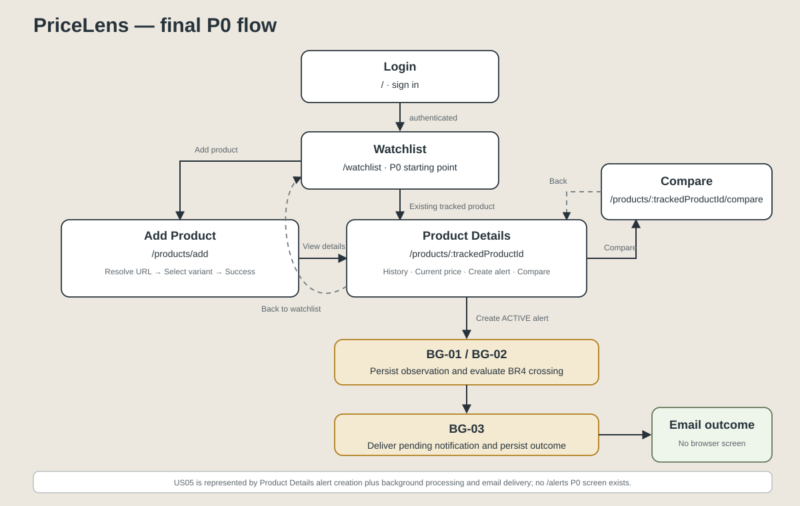
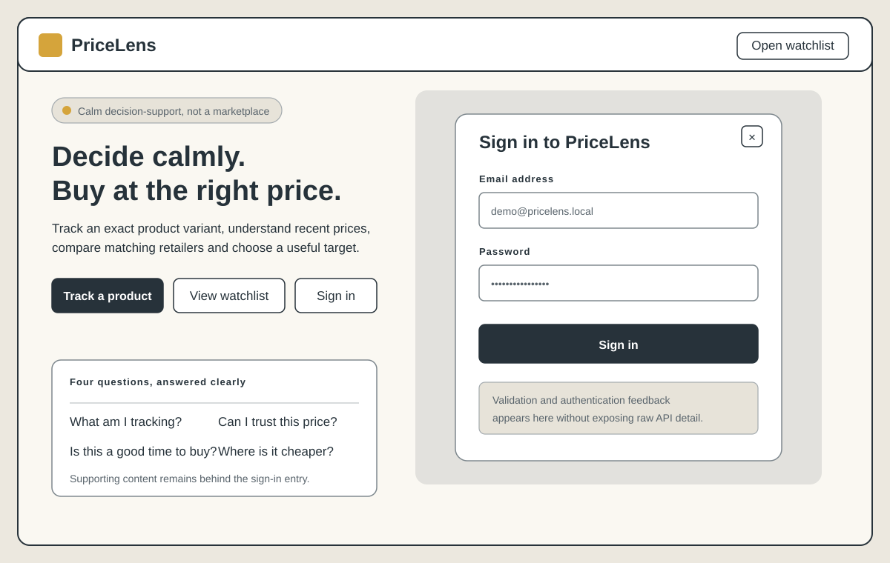
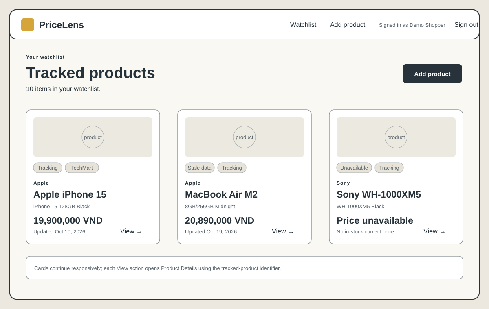
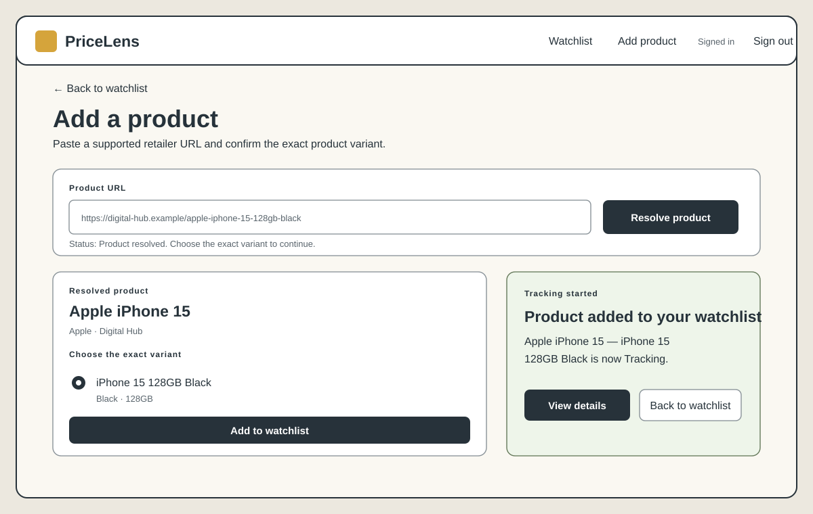
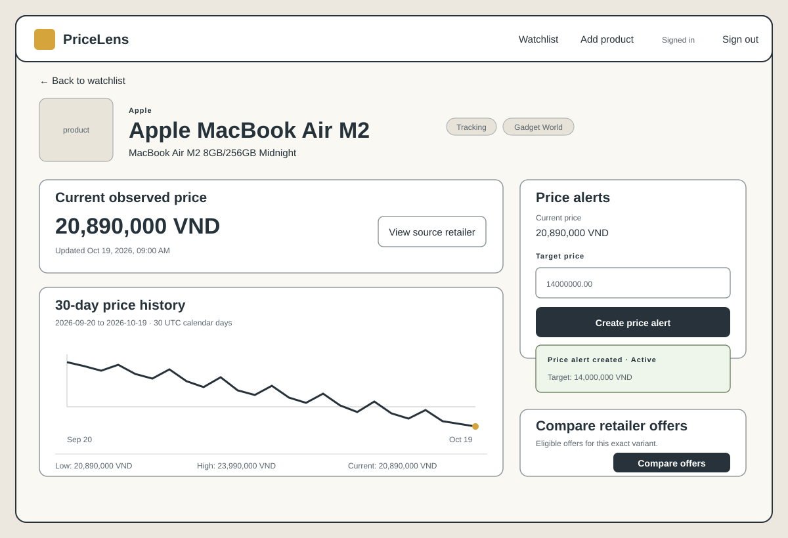
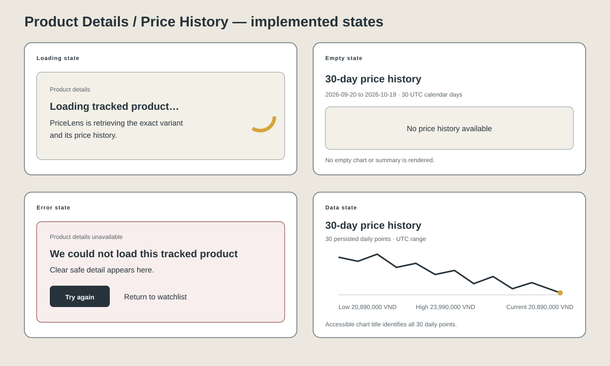
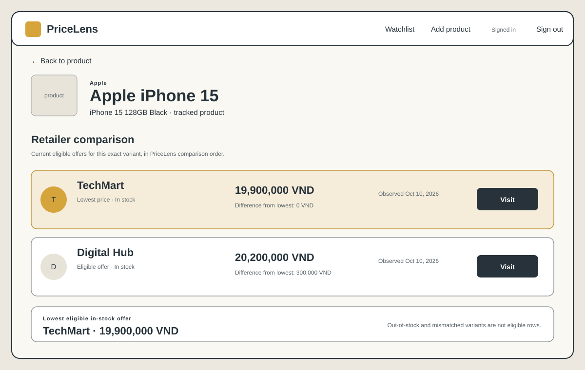

# 1. P0 stories and status

This document records the final Milestone 3 browser experience verified in the current PriceLens implementation and the [P0 acceptance record](p0-acceptance.md). The runtime route parameter `trackedProductId` is the authenticated user's `tracked_products.tracked_product_id`; it is not a catalogue `product_id`.

| Story | Screen(s) | Route | Status | Issue |
|---|---|---|---|---|
| US02 — View product price history | Product Details / Price History | `/products/:trackedProductId` | works | #37 |
| US03 — Create a price alert | Product Details / Create Alert | `/products/:trackedProductId` | works | #38 |
| US04 — Add a product using its URL | Add Product | `/products/add` | works | #39 |
| US05 — Receive a price-drop notification | Product Details alert state, followed by background processing and email | `/products/:trackedProductId` (no dedicated notification route) | works | #40 |
| US09 — Compare prices across retailers | Compare | `/products/:trackedProductId/compare` | works | #56 |

All five statuses use the assignment vocabulary `works`, based on the 18/18 acceptance-criteria result recorded by #151.

## Final implemented P0 flow



```text
Login
→ Watchlist
   ├─→ Add Product
   │    → Resolve URL
   │    → Select variant
   │    → Success
   │    → Product Details
   └─→ Existing tracked product
        → Product Details
           ├─→ Create Alert
           ├─→ Compare
           │    → Back to Product Details
           └─→ Back to Watchlist

Active Alert
→ BG-01/BG-02
→ BG-03
→ Email outcome
```

US05 has no separate browser screen. The browser creates and shows the active-alert result on Product Details; scheduled observation and threshold-evaluation work (BG-01/BG-02), notification delivery (BG-03), and the email are system outcomes.

# 2. Wireframes

The wireframes below describe the implemented page hierarchy rather than a visual redesign. Each screen keeps server-owned validation and comparison decisions in the API and presents safe, task-specific feedback to the user.

## 2.1 Login

- **Route:** `/`
- **Purpose:** The user comes here to sign in to PriceLens and start the authenticated P0 flow.
- **APIs:** `GET /api/auth/session`; `POST /api/auth/login`.



The landing page opens a sign-in dialog with email and password fields. A valid session or successful sign-in sends the user to Watchlist. The submit button is disabled while the request is pending, and credentials are never included in an error detail.

## 2.2 Watchlist

- **Route:** `/watchlist`
- **Purpose:** The user comes here to review tracked products and open Add Product or Product Details.
- **APIs:** `GET /api/auth/session`; `GET /api/watchlist`; `POST /api/auth/logout`.



The page renders database-backed tracked-product cards with variant, tracking status, latest eligible price or unavailable state, retailer context, and a **View** link. **Add Product** opens the registration flow. Shared header controls expose the signed-in user and sign-out action.

## 2.3 Add Product

- **Route:** `/products/add`
- **Purpose:** The user comes here to resolve a supported product URL, choose the exact variant and add it to the watchlist.
- **APIs:** `GET /api/auth/session`; `POST /api/product-sources/resolve`; `POST /api/tracked-products`; `POST /api/auth/logout`.



Resolving a URL shows the normalized product and its selectable variants. Adding the selected retailer offer creates the authenticated user's tracked product. The success state provides navigation to Product Details and back to Watchlist; there are no review, rating, or retailer-fetch controls.

## 2.4 Product Details

- **Route:** `/products/:trackedProductId`
- **Purpose:** The user comes here to review the current price and price history, create a price alert, or open comparison.
- **APIs:** `GET /api/auth/session`; `GET /api/watchlist`; `GET /api/tracked-products/{tracked_product_id}/price-history`; `POST /api/tracked-products/{tracked_product_id}/alerts`; `POST /api/auth/logout`.



The page resolves the owned tracked-product context from Watchlist data and loads the fixed 30-day UTC price-history contract. It combines current price, chart and summary, alert creation, and the handoff to Compare. A created alert is shown as active on this page; the page does not display an alert-management list or simulate notification delivery.

### Empty state

When the API returns `NO_HISTORY`, the user sees exactly **No price history available** with no chart or summary. Product context and the other valid page actions remain available.

### Loading state

While owned product context and history are loading, the page shows **Loading tracked product…** and **PriceLens is retrieving the exact variant and its price history.** The page-state region exposes its busy state to assistive technology.

### Error state

When the page cannot load, the user sees **We could not load this tracked product**, a safe contextual message, and **Try again** and **Return to watchlist** actions. A missing or unowned identifier is presented without exposing another user's record.

### Data state

For `AVAILABLE`, the user sees dated price points in the chart plus low, high, and current summaries for the documented 30-day UTC range. For `INSUFFICIENT_DATA`, the page preserves the one valid point and summary and displays **Insufficient data for a 30-day chart** instead of pretending that a trend exists.



## 2.5 Compare

- **Route:** `/products/:trackedProductId/compare`
- **Purpose:** The user comes here to compare eligible retailer offers for the same exact product variant.
- **APIs:** `GET /api/auth/session`; `GET /api/tracked-products/{tracked_product_id}/offers`; `POST /api/auth/logout`.



The page shows the exact product and variant, eligible in-stock retailer offers, the backend-selected lowest offer, and each offer's difference from that lowest price. The API is authoritative for filtering, order, lowest selection, and differences. **Back to product** returns to Product Details.

# 3. Error messages

The frontend branches on stable `application/problem+json` codes and shows controlled messages. It does not expose raw HTTP status text, JSON, SQL, provider details, or stack traces.

| API code/state | User-visible message | Screen | Business Rule | Notes |
|---|---|---|---|---|
| `INVALID_CREDENTIALS` | `Invalid email or password.` | Login | — | Generic for an unknown email, wrong password, or inactive account. |
| `TARGET_PRICE_NOT_BELOW_CURRENT` | `Target price must be lower than the current price` | Product Details | BR2 | Exact #151 message; no alert is created. |
| `TARGET_PRICE_NOT_POSITIVE` | `Target price must be greater than 0` | Product Details | BR2 | Exact #151 message; no alert is created. |
| `ACTIVE_ALERT_LIMIT_REACHED` | `Maximum 20 active alerts reached` | Product Details | BR1 | Exact #151 message; active-alert count remains 20. |
| `DUPLICATE_TRACKED_URL` | `This product URL is already being tracked` | Add Product | BR6 | Applies after URL normalization; no duplicate tracked row is created. |
| `INVALID_PRODUCT_URL` | `Unsupported or invalid product URL` | Add Product | — | Used for malformed URLs and unsupported sources. |
| `TRACKED_PRODUCT_NOT_FOUND` | `The tracked product could not be found.` | Product Details, Compare | — | Missing and unowned identifiers share the same safe outcome. |
| `INSUFFICIENT_DATA` | `Insufficient data for a 30-day chart` | Product Details | — | A successful price-history state with one valid point, not an API error. |
| `NO_HISTORY` | `No price history available` | Product Details | — | A successful price-history state with zero points. |
| `SINGLE_OFFER` | `No multi-source comparison is currently available` | Compare | — | A successful comparison state with one eligible offer. |

BR1 limits a user to 20 active alerts. BR2 requires a positive target strictly below the current price. BR6 prevents the same user from tracking the same normalized URL twice. No Business Rule is assigned to a row unless the current requirements explicitly define that relationship.

# 4. What changed since M2

## M2 assumption/design

Milestone 2 proved the authenticated Login → Watchlist browser-to-PostgreSQL slice. The target API design also defined price history (API-02), alert creation (API-05), and exact-variant comparison (API-06), but that walking-skeleton milestone did not settle their final composition into one user-facing decision flow.

## What implementation revealed

Sprint 3 implementation showed that current price, price history, alert creation, and the handoff to retailer comparison all depend on the same owned `tracked_product_id` and exact variant. Presenting them as disconnected conceptual destinations would repeat context, encourage typed identifiers, and make loading and validation feedback harder to understand.

## Final Sprint 3 design

Product Details at `/products/:trackedProductId` is now the hub for that decision flow. It resolves the owned tracked-product context from `GET /api/watchlist`, obtains the server-defined 30-day UTC history through API-02, submits active alerts through API-05, and links the same tracked identity to the API-06 Compare screen. Compare remains a separate focused page, and its backend response remains authoritative for eligible offers, sort order, lowest offer, and differences.

The route identity is `tracked_products.tracked_product_id`. API contracts, the PostgreSQL data model, ownership enforcement, Business Rules, background notification processing, and email delivery are unchanged.

## Why the change was needed

The consolidated page gives the user one coherent product context for assessing a trend, setting a threshold, and deciding whether to compare retailers. It also keeps API states and errors next to the action that produced them without duplicating server business logic in the frontend.

## Affected surfaces and implementation evidence

| Area | Final effect | Evidence |
|---|---|---|
| Screen | Product Details combines current-price context, history, alert creation, and Compare navigation. | [`frontend/products/product.html`](../frontend/products/product.html), [`frontend/src/pages/product-detail.js`](../frontend/src/pages/product-detail.js) |
| Route | The page and its Compare handoff use the owned runtime identity `:trackedProductId`. | [`frontend/src/pages/product-detail.js`](../frontend/src/pages/product-detail.js), [`frontend/src/pages/product-compare.js`](../frontend/src/pages/product-compare.js) |
| APIs | API-02, API-05, and API-06 retain their documented responsibilities; the UI only orchestrates them. | [`design.md`](design.md) |
| Data model | No schema or identifier meaning changed. | [`design.md`](design.md), [`requirements.md`](requirements.md) |
| QA | The integrated flow and all five P0 stories were verified through the normal UI. | [`p0-acceptance.md`](p0-acceptance.md) |

